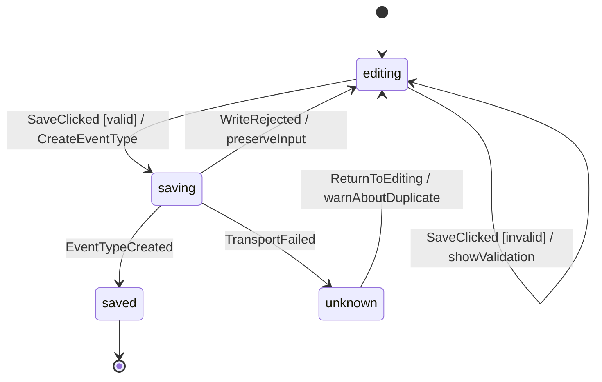
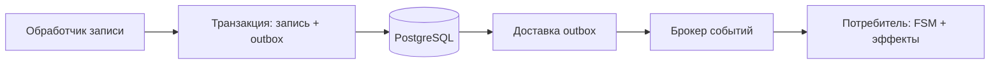

# Event-Driven Architecture (EDA) с конечными автоматами (FSM)

Дата проверки источников: 22 октября 2026 года.

Справочный обзор сочетания двух подходов. Примеры локальных автоматов и
распределённой доставки ниже не означают, что проект уже использует брокер или FSM.

## Что дают EDA и FSM

В EDA производители сообщают о событиях, а потребители реагируют через канал
доставки. Производителю не обязательно знать всех потребителей. В распределённой
системе это позволяет независимо развивать обработчики, но усложняет наблюдение
за цепочкой, обработку ошибок и согласованность данных.
[Источник: Microsoft — Event-driven architecture style](https://learn.microsoft.com/en-us/azure/architecture/guide/architecture-styles/event-driven).

FSM описывает допустимые реакции на событие в зависимости от текущего состояния.
В базовом автомате активно одно состояние; переход может иметь условие (guard)
и действия. Statecharts расширяют модель вложенными и параллельными состояниями.
[Источник: W3C SCXML, раздел 3.1](https://www.w3.org/TR/scxml/#state-machine-notation).

EDA отвечает на вопрос «кто узнаёт о произошедшем?», FSM — «какая реакция допустима
сейчас?». Их сочетание полезно для процессов, где одинаковое событие в разных
состояниях должно обрабатываться по-разному.

## События, команды и эффекты

| Понятие | Значение | Пример |
| --- | --- | --- |
| Команда | Поручение выполнить операцию; возможен отказ | `CreateEventType` |
| Событие | Сообщение о действии или произошедшем результате | `SaveClicked`, `EventTypeCreated` |
| Состояние | Текущая фаза поведения | `editing`, `saving`, `saved` |
| Контекст | Данные экземпляра автомата | Введённые поля, ошибка, ID запроса |
| Guard | Условие разрешения перехода | Поля удовлетворяют локальным правилам |
| Эффект | Взаимодействие с внешним миром | HTTP-запрос создания |

`SaveClicked` фиксирует действие пользователя, а не успешное сохранение.
`EventTypeCreated` следует выдавать после подтверждения записи сервером.
Доменный **тип события** из [глоссария](../../GLOSSARY.md) — вид встречи; это другое
понятие, чем архитектурное событие о выполненной операции.

В модели с чистым переходом удобно использовать форму:

```text
transition(state, context, event) -> (nextState, nextContext, effects)
```

Обработчик эффектов выполняет I/O и возвращает новое событие. Это выбранный для
примера способ отделить решение от исполнения, а не обязательная сигнатура любой
FSM. Guard должен быстро и предсказуемо проверять данные, не выполнять сетевой
запрос; Stately описывает guards как чистые синхронные функции.
[Источник: Stately — Guards](https://stately.ai/docs/guards).

## Пример: форма создания типа события



Это автомат интерфейса, а не жизненный цикл записи в БД. Типу события не требуется
новое поле `status`. В состоянии `saving` повторный `SaveClicked` не запускает
новую запись; для событий без перехода политика должна быть явной, например
игнорирование с диагностикой.

При сетевом сбое сервер мог уже сохранить запись. Поэтому `unknown` означает
неизвестный результат, а не подтверждённый отказ. Возврат к редактированию должен
предупредить о возможном дубликате. Автоматический повтор записи безопасен только
при наличии соответствующей серверной гарантии, например ключа идемпотентности.
Такой гарантии нельзя приписывать существующему API без изменения контракта.

При нескольких запросах полезно включать ID запроса в события результата, чтобы
игнорировать устаревший ответ. Сами переходы выбираются из доступных в текущем
состоянии; принципы обработки событий и переходов описаны в
[Stately — Events and transitions](https://stately.ai/docs/transitions).

## Локальная модель и распределённая EDA

Локальный dispatch, очередь внутри процесса или reducer могут реализовать реакцию
на события без сети. Это ещё не даёт долговечной доставки между приложениями:
закрытие вкладки или падение процесса уничтожает несохранённую работу.

Для распределённого варианта пример потока выглядит так:



Outbox решает проблему двойной записи: изменение предметных данных и намерение
отправить событие фиксируются одной транзакцией. Отдельный доставщик публикует
зафиксированные события. Дубли при доставке остаются возможны; потребитель должен
быть идемпотентным. Откат транзакции не должен приводить к публикации.
[Источник: AWS — Transactional outbox](https://docs.aws.amazon.com/prescriptive-guidance/latest/cloud-design-patterns/transactional-outbox.html).

Практический вариант надёжного потребителя: в одной локальной транзакции проверить
`eventId`, сохранить новое состояние с контролем версии и отметить событие
обработанным. Сообщение подтверждается после commit. Для внешнего эффекта, например
вызова чужого API, нужен отдельный механизм безопасного повтора: транзакция своей
БД не охватывает внешний сервис.

## Что требуется продумать при распределённой доставке

- **Дубли и порядок.** Использовать ID события, ключ экземпляра и при необходимости
  номер версии. Время события само по себе не гарантирует порядок доставки.
- **Конкуренция.** Сериализовать изменения одного экземпляра или применять
  оптимистическую блокировку с обработкой конфликта.
- **Повторы.** Ограничивать retry, различать временные и постоянные ошибки;
  предусмотреть карантин сообщений (DLQ) и управляемый повтор обработки.
- **Контракты.** Версионировать формат сообщений и обеспечивать совместимость
  одновременно работающих производителей и потребителей.
- **Наблюдаемость.** Записывать ID события, экземпляра и причинной цепочки, старое
  и новое состояние, задержку и причину отказа.

Это рекомендации проектирования для распределённого примера. Брокер, outbox и FSM
по отдельности не дают сквозного exactly-once для всех внешних эффектов. Microsoft
отдельно рассматривает порядок, однократную обработку и eventual consistency как
проблемы EDA. Критический запрет пересекающихся бронирований следует обеспечивать
атомарно при записи, а не надеяться на последующую доставку событий.
[Источник: Microsoft — Challenges](https://learn.microsoft.com/en-us/azure/architecture/guide/architecture-styles/event-driven#challenges).

## Ограничения и соседние подходы

FSM полезна при нескольких фазах, запретах и ветвях ошибок. Для простого обработчика
без жизненного цикла явный автомат может добавить лишнюю модель. При большом числе
независимых признаков плоская FSM разрастается; стоит рассмотреть независимые
автоматы либо вложенные и параллельные состояния.

EDA не равна Event Sourcing: в последнем изменения состояния сохраняются как
последовательность событий, из которой состояние можно восстановить. Обычная EDA
может хранить текущее состояние в таблицах и передавать только уведомления.
[Источник: Martin Fowler — Event Sourcing](https://martinfowler.com/eaaDev/EventSourcing.html).

[Workflow](workflow-based-architecture.md) организует выполнение шагов, а FSM
ограничивает допустимые состояния и реакции. Они могут использовать общую модель,
но не стоит независимо поддерживать две противоречащие друг другу версии процесса.
[Feature-Based](feature-based-architecture.md) и
[Vertical Slice](vertical-slice-architecture.md) определяют, где этот код расположен.

## Как проверять

Для локальной FSM полезны табличные тесты переходов, запрет повторного сохранения,
сохранение ввода, устаревшие ответы и неизвестный результат записи. Для
распределённого варианта дополнительно нужны дубли, нарушение порядка, конфликт
версий, сбой после commit до подтверждения сообщения и восстановление обработчика.

## Источники

- [Microsoft: Event-driven architecture style](https://learn.microsoft.com/en-us/azure/architecture/guide/architecture-styles/event-driven) — взаимодействие компонентов и ограничения EDA.
- [W3C: SCXML](https://www.w3.org/TR/scxml/) — состояния, переходы и расширения statecharts.
- [Stately: Events and transitions](https://stately.ai/docs/transitions) и [Guards](https://stately.ai/docs/guards) — практическая семантика автоматов.
- [AWS: Transactional outbox](https://docs.aws.amazon.com/prescriptive-guidance/latest/cloud-design-patterns/transactional-outbox.html) — атомарная запись и публикация.
- [Martin Fowler: Event Sourcing](https://martinfowler.com/eaaDev/EventSourcing.html) — отличие способа хранения от способа взаимодействия.
