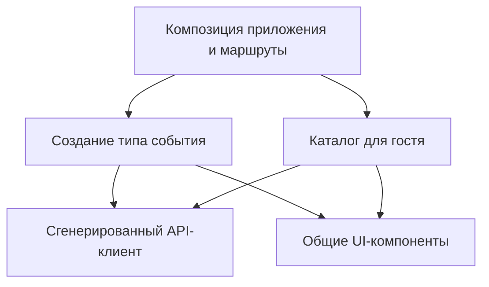

# Feature-Based Architecture

Дата проверки источников: 22 октября 2026 года.

Справочный обзор подхода. Примеры ниже иллюстрируют возможную организацию проекта,
а не фиксируют принятое архитектурное решение или текущее устройство кода.

## Суть подхода

Feature-Based Architecture организует код вокруг функций продукта: «создать тип
события», «показать каталог», «настроить расписание». Связанные UI, состояние,
проверки и обращения к API находятся рядом. При изменении функции разработчик
начинает с её модуля, а не собирает реализацию из общих каталогов `components`,
`hooks`, `services` и `validators`.

Практический пример такого принципа — рекомендация Redux хранить относящиеся к
одной функции файлы в feature folder. Это рекомендация по совместному размещению
кода, а не требование использовать Redux в любом приложении.
[Источник: Redux Style Guide](https://redux.js.org/style-guide/#structure-files-as-feature-folders-with-single-file-logic).

Термин не задаёт единственного обязательного дерева каталогов. Здесь под ним
понимается организация по функциям с явными границами модулей; конкретные правила
импортов команда определяет отдельно. Подход применим и к frontend, и к backend.

## Границы и зависимости

Для этого проекта можно рассматривать следующие правила как отправную точку:

1. Название feature описывает возможность пользователя, а не техническую роль.
2. Модуль предоставляет небольшой публичный API; внутренние файлы остаются деталями.
3. Композиция экранов и маршрутов находится выше отдельных features.
4. Общие технические средства не импортируют бизнес-функции.
5. Общие бизнес-правила получают одного владельца; одинаковые фрагменты оформления
   сами по себе ещё не доказывают необходимость общей бизнес-абстракции.

Публичный API снижает зависимость потребителей от внутренней структуры модуля.
В Feature-Sliced Design это отдельный контракт, обычно оформленный через явные
экспорты. Такой приём можно использовать и без принятия всей методологии FSD.
[Источник: FSD — Public API](https://feature-sliced.design/docs/reference/public-api).



Стрелки показывают зависимости кода. Здесь нет предположения, что каталог должен
импортировать форму создания или что frontend и backend должны стать одним модулем.

## Пример структуры

Иллюстративный вариант для React, без обязательного соответствия FSD:

```text
frontend/src/
  app/                         # маршруты, провайдеры, композиция
  features/
    create-event-type/
      CreateEventTypeForm.tsx
      model.ts                 # состояние формы и правила переходов
      validation.ts
      api.ts                   # адаптер сгенерированного клиента
      index.ts                 # публичные экспорты
    browse-event-types/
      EventTypeCatalog.tsx
      model.ts
      api.ts
      index.ts
  shared/
    ui/
  api/generated/               # существующая точка генерации клиента
```

Например, добавление сообщения об ошибке длительности затрагивает модуль создания.
Изменение общего транспортного контракта затрагивает `api/main.tsp` и потребителей
контракта. Граница feature локализует обычные изменения, но не делает общие
контракты независимыми от всех функций.

На Go аналогом может быть пакет сценария в `internal/`, который экспортирует
регистрацию HTTP-обработчика или функцию выполнения сценария. Регистр букв в имени
идентификатора задаёт видимость; TypeScript barrel-файл не является механизмом Go.
Подключение к PostgreSQL, миграции и сгенерированный sqlc-код могут оставаться общей
инфраструктурой согласно [ADR-0014](../adr/0014-postgresql-and-sqlc.md).

## Отличие от Feature-Sliced Design и Vertical Slice

Feature-Sliced Design — конкретная методология frontend с уровнями App, Pages,
Widgets, Features, Entities, Shared. Уровень Processes объявлен устаревшим.
По общему правилу slice импортирует другие slices только с нижележащих уровней;
App и Shared имеют особую организацию. Простая папка `features/` не означает
соблюдения FSD, и создавать все уровни заранее не требуется.
[Источник: FSD — Layers](https://feature-sliced.design/docs/reference/layers).

| Подход | Основной вопрос | Возможная единица организации |
| --- | --- | --- |
| Feature-Based | Где находится реализация функции продукта? | Модуль управления расписанием |
| [Vertical Slice](vertical-slice-architecture.md) | Где полностью реализован конкретный сценарий? | Сохранение недельного расписания от запроса до БД |
| Feature-Sliced Design | Как распределены frontend-модули и разрешены импорты? | Slice на определённом уровне |

Граница между Feature-Based и Vertical Slice не универсальна: маленькая feature
может целиком совпадать с одним срезом. В этой серии документов различие используется
для обсуждения масштаба модулей, а не как строгая классификация всех реализаций.

## Когда полезен и какие есть ограничения

Подход помогает, если задачи обычно сформулированы как изменения конкретных
пользовательских возможностей и работа часто рассредоточена по техническим папкам.
Он также позволяет обсуждать владельца и публичный контракт каждой функции.

Практические риски для такой структуры:

- Слишком крупная feature становится новым монолитом. Например, `calendar` может
  скрыть и расписание, и бронирование, и каталог.
- Взаимные импорты между features создают циклы. Общую композицию лучше поднять
  на уровень приложения или явно выделить совместно используемую модель.
- Каталог `shared` может накопить несвязанные правила. Для каждого общего модуля
  полезно уметь назвать назначение и потребителей.
- Копирование серверных ограничений в UI не заменяет проверку на backend и в БД.

Это инженерные выводы для приведённого примера, а не дополнительные правила Redux
или FSD. Для маленького приложения отдельная папка под каждую кнопку усложнит поиск
кода; разумная граница — самостоятельная пользовательская возможность.

## Как вводить и проверять

Начать можно с одной функции: собрать её код, обозначить публичный API, проверить
внешние импорты и описать зависимости. После этого оценить на следующем изменении,
стало ли проще найти нужный код. Массовое перемещение файлов не требуется.

В примере создания типа события полезны проверки поведения: невалидная
длительность отклоняется, корректные данные сохраняются, ошибка сохраняет введённый
текст, каталог получает сохранённую запись. Проверка границ импортов дополняет эти
тесты, но не заменяет их.

Внутри feature можно использовать [FSM и события](event-driven-architecture-fsm.md)
для состояния и [workflow](workflow-based-architecture.md) для выполнения шагов.
Организация файлов сама по себе не требует брокера сообщений или workflow engine.

## Источники

- [Redux Style Guide: Feature Folders](https://redux.js.org/style-guide/#structure-files-as-feature-folders-with-single-file-logic) — пример группировки кода по функциям.
- [Feature-Sliced Design: Public API](https://feature-sliced.design/docs/reference/public-api) — контракты и инкапсуляция модулей.
- [Feature-Sliced Design: Layers](https://feature-sliced.design/docs/reference/layers) — особенности FSD и правила зависимостей.
