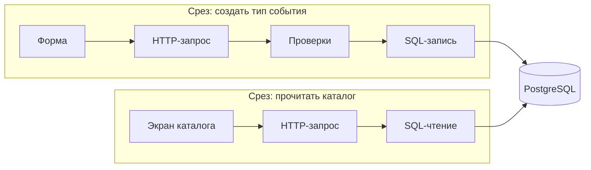

# Vertical Slice Architecture

Дата проверки источников: 22 октября 2026 года.

Справочный обзор. Примеры для календарного бронирования — варианты проектирования,
а не описание уже принятой структуры репозитория.

## Суть подхода

Vertical Slice Architecture строит приложение вокруг конкретных сценариев:
«создать тип события», «прочитать каталог», «создать бронирование». Срез объединяет
относящиеся к запросу части реализации от входа до результата, пересекая обычные
технические слои. Основная цель — высокая связность внутри сценария и слабая
связанность между сценариями.

В исходной статье Jimmy Bogard каждый запрос рассматривается как отдельный use
case. Для простого сценария допустимо простое решение, для сложного — более
выразительная доменная модель. Единая цепочка `Controller → Service → Repository`
для всех запросов не является обязательной.
[Источник: Jimmy Bogard — Vertical Slice Architecture](https://www.jimmybogard.com/vertical-slice-architecture/).



Схема показывает охват поведения. Она не требует общей сборки frontend и backend,
одного языка или единственного физического каталога для всего среза.

## Как определить границу среза

Для примера «создать тип события» границу удобно описать через четыре вопроса:

| Вопрос | Ответ в примере |
| --- | --- |
| Кто запускает сценарий? | Владелец календаря отправляет форму |
| Что принимается? | Название, необязательное описание, длительность |
| Что гарантируется? | Проверенные данные сохранены; ID назначает БД |
| Как наблюдается результат? | HTTP-ответ и состояние формы |

Каталог гостя — другой сценарий: он читает записи и не должен вызывать обработчик
создания. Общая таблица не заставляет объединять чтение и запись в один универсальный
сервис. При этом общие ограничения длительности должны оставаться согласованными.

Пример организации backend, не предписание переместить существующие файлы:

```text
backend/internal/
  eventtypes/
    create/
      handler.go
      create.go
      create_test.go
    catalog/
      handler.go
      catalog.go
      catalog_test.go
  database/                    # подключение и генерация sqlc
  httpserver/                  # регистрация маршрутов
```

Если небольшому срезу достаточно одного файла, дробить его на `handler`, `service`
и `repository` только ради симметрии не нужно. На frontend соответствующая часть
может находиться в feature-модуле; API между приложениями остаётся в TypeSpec.
Это совместимо с постепенным добавлением бизнес-кода из
[ADR-0006](../adr/0006-standalone-backend.md) и SQL-подходом из
[ADR-0014](../adr/0014-postgresql-and-sqlc.md).

## Логика внутри среза

Для короткого сценария подходит Transaction Script: процедура обрабатывает один
запрос, выполняет проверки и обращается к хранилищу напрямую либо через тонкую
обёртку. Общие подзадачи могут быть отдельными процедурами.
[Источник: Martin Fowler — Transaction Script](https://martinfowler.com/eaaCatalog/transactionScript.html).

Для нашего примера это означает последовательность: разобрать вход, нормализовать
название, проверить длительность, вызвать sqlc и преобразовать результат в ответ.
Если позже сложность окажется в расчёте доступности слота, соответствующие правила
можно выделить в самостоятельную модель, а не раздувать HTTP-обработчик.

Практический критерий выделения общего кода: это одно правило, которое должно
изменяться одновременно у всех потребителей, или случайно похожая реализация?
Например, атомарная защита от пересечения бронирований должна иметь согласованный
механизм в БД; локализация срезов не разрешает каждому записывать данные в обход него.

## Связь с CQRS и другими подходами

CQRS разделяет модели изменения и чтения данных. Такое разделение удобно при
разных требованиях к записи и представлению, но добавляет сложность и подходит
не каждой системе. Само наличие отдельных GET- и POST-обработчиков ещё не означает
полноценного разделения моделей.
[Источник: Martin Fowler — CQRS](https://martinfowler.com/bliki/CQRS.html).

В примере создания и каталога можно оставить одну PostgreSQL и текущие таблицы.
Организация по срезам сама по себе не требует отдельных хранилищ, Event Sourcing,
очереди, mediator-библиотеки или микросервисов. Это разные решения, требующие своих
оснований. У Bogard CQRS связан с его вариантом применения VSA; это не повод
автоматически переносить всю инфраструктуру его стека в Go.

| Подход | Что определяет в примере |
| --- | --- |
| [Feature-Based](feature-based-architecture.md) | Модули функций продукта; одна feature может включать несколько сценариев |
| Vertical Slice | Границы конкретного запроса и его реализации |
| [EDA с FSM](event-driven-architecture-fsm.md) | Реакции на события и допустимые состояния |
| [Workflow](workflow-based-architecture.md) | Порядок шагов и обработку их результатов |

Эти подходы могут применяться одновременно. Терминология Feature-Based и VSA
пересекается; полезнее согласовать реальные границы, чем опираться только на название.

## Преимущества, ограничения и применение

VSA полезна, когда изменения обычно относятся к одному сценарию, а единые
технические слои заставляют менять много общих классов. Вариативность реализации
позволяет не навязывать сложному бронированию и простому чтению каталога одинаковые
абстракции. Bogard отдельно отмечает необходимость навыков рефакторинга: сложную
логику надо вовремя переносить из обработчиков в подходящую модель.
[Источник: ограничения VSA у Bogard](https://www.jimmybogard.com/vertical-slice-architecture/).

Для рассматриваемого проекта основные риски — расхождение общих правил между
срезами, несогласованная обработка ошибок и изменения общей схемы, влияющие сразу
на несколько сценариев. Поэтому формат ошибок, инфраструктуру и инварианты БД
нужно согласовывать независимо от расположения файлов.

Вводить подход можно на одном новом сценарии. Сначала определить вход, результат
и ошибки, затем реализовать минимальный путь и проверить поведение через публичную
границу. Для записи нужны проверки фактического сохранения и ограничений в реальной
БД; для HTTP — контракта и ошибок; для UI — доступного пользователю результата.
Количество внутренних интерфейсов не является критерием качества среза.

## Источники

- [Jimmy Bogard: Vertical Slice Architecture, 2018](https://www.jimmybogard.com/vertical-slice-architecture/) — исходное объяснение, ось изменений и ограничения.
- [Martin Fowler: Transaction Script](https://martinfowler.com/eaaCatalog/transactionScript.html) — простой вариант реализации сценария.
- [Martin Fowler: CQRS](https://martinfowler.com/bliki/CQRS.html) — разделение моделей чтения и записи и его цена.
