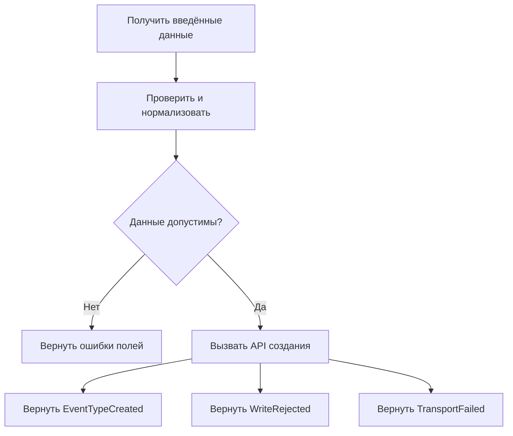

# Workflow-based architecture

Дата проверки источников: 22 октября 2026 года.

Справочный обзор организации приложения вокруг процессов. Упоминание платформ
и примеры не означают решения внедрить workflow engine в этот проект.

## Суть подхода

Workflow явно описывает, какие шаги выполняются для достижения результата,
в каком порядке, при каких условиях и что происходит при ошибке. Архитектура
строится вокруг исполняемых процессов, а отдельные операции становятся их шагами.
Процесс может содержать ветвления, параллельную работу, ожидание события или человека.

Camunda описывает process orchestration как координацию частей бизнес-процесса:
модель процесса развёртывается в движке, а экземпляр проходит задачи, которые
выполняют workers. Процесс и его отдельное исполнение — разные понятия.
[Источник: Camunda — Processes](https://docs.camunda.io/docs/components/concepts/processes/).

Термин Workflow-based architecture не задаёт одну обязательную технологию. В этом
документе он охватывает как короткую координацию в коде, так и процессы с сохранением
прогресса. Обычная последовательность `await` сама по себе не обеспечивает
восстановление после перезапуска.

## Основные элементы

| Элемент | Роль |
| --- | --- |
| Определение процесса | Шаги, условия, ожидания и обработка ошибок |
| Экземпляр процесса | Один запуск со своим ID, входом и прогрессом |
| Шаг / activity / task | Отдельная операция, например чтение или запись |
| Worker | Исполнитель прикладного кода шага |
| Оркестратор | Выбор следующего шага, координация результатов |
| Сохраняемая история или состояние | Основа восстановления долговечного процесса |
| Сообщение и таймер | Внешнее продолжение и ожидание до заданного момента |

Названия и точные гарантии зависят от платформы. В Temporal определение workflow
— код, а execution — его долговечное исполнение; состояние восстанавливается с
использованием истории. Это конкретная реализация durable execution, а не свойство
любой функции с названием `workflow`.
[Источник: Temporal — Workflow Execution](https://docs.temporal.io/workflow-execution).

## Варианты реализации

| Вариант | Когда подходит | Что учитывать |
| --- | --- | --- |
| Функция-координатор в приложении | Короткий сценарий в пределах запроса или экрана | Прогресс в памяти исчезает при остановке |
| Свой сохраняемый процесс в БД | Немного простых фоновых этапов | Самостоятельно реализуются захват задач, таймеры, retry и восстановление |
| Workflow-as-code, например Temporal | Долгие процессы и координация отказоустойчивых шагов | Ограничения SDK, replay и версии кода |
| BPMN-движок, например Camunda | Нужна исполняемая диаграмма и участие людей | Модель процесса, workers и эксплуатация движка |
| Облачный сервис, например AWS Step Functions | Оркестрация сервисов выбранной платформы | Гарантии, ограничения и стоимость конкретного режима |

В Step Functions Standard и Express различаются семантикой исполнения; даже внутри
Express синхронный и асинхронный режимы имеют разные гарантии. Выбирать платформу
только по слову «workflow» недостаточно.
[Источник: AWS — Choosing workflow type](https://docs.aws.amazon.com/step-functions/latest/dg/choosing-workflow-type.html).

## Пример: создание типа события

Для существующей предметной области достаточно показать короткий frontend-сценарий:

Стрелки после API обозначают альтернативные результаты, а не три последовательных
шага. Координатор выполняет I/O и возвращает события в
[FSM формы](event-driven-architecture-fsm.md). Автомат решает, какие действия
разрешены и что показать пользователю. Повторная валидация backend и ограничения БД
остаются обязательными независимо от проверки в браузере.

Это локальный workflow без сохранения прогресса и отдельного сервера оркестрации.
При потерянном ответе запись могла завершиться: нельзя автоматически считать её
неуспешной и безусловно повторять. Каталог гостя читает сохранённые данные отдельным
сценарием. Создание бронирования по [глоссарию](../../GLOSSARY.md) не требует подтверждения
владельца; добавлять ожидание такого подтверждения ради демонстрации workflow нельзя.

## Долговечность, повторы и версии

Долговечный workflow становится полезен, если нужно ждать внешнее событие, переживать
перезапуски или координировать операции, которые не помещаются в одну транзакцию.
Для проектирования такого варианта необходимо определить:

1. Как уникально идентифицируется процесс и предотвращается повторный запуск.
2. Что сохраняется до и после выполнения каждого шага.
3. Какие ошибки допускают retry, с каким интервалом и общим сроком.
4. Как сообщения сопоставляются с экземпляром и обрабатываются после завершения.
5. Что произойдёт при отмене, истечении срока и обновлении определения процесса.

В Temporal workflow-код при replay должен выдавать совместимую последовательность
команд. I/O выносят в activities, а время и другие недетерминированные операции
получают через предусмотренные SDK механизмы. Изменения порядка шагов работающего
workflow требуют стратегии версионирования, например patching или Worker Versioning.
Эти ограничения относятся к Temporal; переносить их буквально на любой BPMN-движок
или собственный координатор не следует.
[Источник: Temporal — Workflow Definition](https://docs.temporal.io/workflow-definition).

Успешно зафиксированная activity не исполняется заново при обычном replay. Но если
внешний эффект выполнен, а его результат не дошёл до платформы, попытка может
повториться. Поэтому запись и внешние вызовы должны поддерживать идемпотентность,
например по стабильному ключу операции. Надёжность workflow не превращает произвольный
внешний API в exactly-once.
[Источник: Temporal — Activity Definition](https://docs.temporal.io/activity-definition).

## Транзакции и компенсации

Workflow из нескольких шагов не является общей ACID-транзакцией. Если данные
меняются в одной PostgreSQL и нужный инвариант можно обеспечить одной транзакцией,
оркестратор не даёт оснований разбивать её на независимо фиксируемые операции.

Для распределённого процесса может применяться saga: координатор запускает локальные
транзакции, а при отказе — бизнес-компенсации завершённых шагов. Компенсация является
новой операцией, не откатом времени; она тоже может завершиться ошибкой. Поэтому
нужны повтор и способ разрешить незавершённый процесс.
[Источник: AWS — Saga orchestration](https://docs.aws.amazon.com/prescriptive-guidance/latest/cloud-design-patterns/saga-orchestration.html).

## Отличие от EDA, FSM и организации по функциям

| Подход | Основная ответственность |
| --- | --- |
| [Feature-Based](feature-based-architecture.md) | Группировка кода по функциям продукта |
| [Vertical Slice](vertical-slice-architecture.md) | Реализация конкретного сценария от входа до результата |
| [EDA](event-driven-architecture-fsm.md) | Взаимодействие производителей и потребителей событий |
| FSM | Допустимые состояния и переходы экземпляра |
| Workflow | Координация шагов, ожиданий и результатов процесса |

При хореографии участники реагируют на события друг друга; при оркестрации
следующий шаг выбирает координатор. Оркестратор тоже может обмениваться событиями.
Workflow часто можно представить автоматом; FSM не обязательно имеет долговечное
исполнение, workers или retry. Это пересекающиеся модели, а не взаимоисключающие
варианты архитектуры.

## Когда применять и как проверять

Явный workflow полезен, когда порядок шагов и восстановление становятся заметной
частью требований. Цена отдельного движка — инфраструктура, совместимость версий,
наблюдение за зависшими процессами и обучение команды. Для короткого сохранения
формы достаточным вариантом может быть функция-координатор.

Проверки следует строить вокруг исходов: успешное завершение, постоянная ошибка,
временный сбой с повтором, неизвестный результат эффекта, дубликат сообщения,
отмена и истечение срока. У долговечного варианта дополнительно проверяются
перезапуск между эффектом и фиксацией результата, совместимость новой версии со
старой историей и ошибки компенсации. В эксплуатации полезны возраст процесса,
время ожидания шага, количество попыток и причина остановки.

## Источники

- [Camunda: Processes](https://docs.camunda.io/docs/components/concepts/processes/) — процесс, модель и исполнение задач.
- [Temporal: Workflow Execution](https://docs.temporal.io/workflow-execution) — экземпляры и восстановление исполнения.
- [Temporal: Workflow Definition](https://docs.temporal.io/workflow-definition) — детерминизм и версии.
- [Temporal: Activity Definition](https://docs.temporal.io/activity-definition) — повторы и идемпотентность эффектов.
- [AWS: Choosing workflow type](https://docs.aws.amazon.com/step-functions/latest/dg/choosing-workflow-type.html) — различия гарантий режимов исполнения.
- [AWS: Saga orchestration](https://docs.aws.amazon.com/prescriptive-guidance/latest/cloud-design-patterns/saga-orchestration.html) — распределённые шаги и компенсации.
